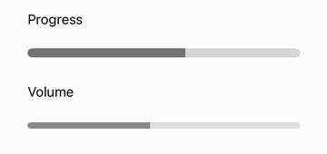
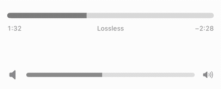
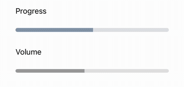
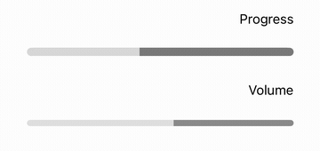

# SliderControl

![Platform badge] ![OS badge] ![SPM badge] ![Swift badge]

SliderControl is a small Swift Package aiming to recreate volume and track sliders found in Apple Music on iOS 16 and later.



## Usage

To use `SliderControl` in **UIKit** projects, simply create it and add as a subview like any other view or control. It maintains an API similar to built-in `UISlider` with the same properties, like `value` and `isContinuous`, and allows you to track the progress by employing the target-action pattern:

```swift
sliderControl.addTarget(self, action: #selector(sliderValueChanged), for: .valueChanged)
```

Alternatively, you can subscribe to `valuePublisher` to receive value updates:

```swift
sliderCancellable = sliderControl.valuePublisher.sink { value in
    ...
}
```

To use the control in **SwiftUI** project, create its wrapper view called `SliderControlView`:

```swift
@State private var sliderValue: Float = 0.5

var body: some View {
    SliderControlView(value: $sliderValue)
}
```

## Customization
#### Progress and volume behavior

Choose the interaction with `behavior`. The default is `.progress`, preserving
the existing drag behavior.

| Behavior | After release | Dragging past either limit |
| --- | --- | --- |
| `.progress` | Stops immediately | Clamps without stretching |
| `.volume` | Coasts according to release velocity | Resists, stretches slightly, then springs back |

The volume bounce only changes the track's appearance. Values and published
updates always stay inside `valueRange`. Both behaviors support RTL.

UIKit:
```swift
progressSlider.behavior = .progress
volumeSlider.behavior = .volume
```

SwiftUI:
```swift
SliderControlView(value: $playbackProgress, in: 0...duration)
SliderControlView(value: $volume, behavior: .volume)
// Equivalent modifier:
SliderControlView(value: $volume).behavior(.volume)
```

With `isContinuous = true` (SwiftUI: `.continuouslyUpdatesValue(true)`), volume
continues sending value updates during inertia. With `false`, it sends the final
value when motion settles. `onEditingChanged(false)` still fires when the finger
lifts. Touching again interrupts inertia; cancellation and removal from the
window stop motion immediately. Setting a different value programmatically also
interrupts inertia, while values supplied during a drag are ignored.

#### Text and icons



Add text below a progress slider, or icons beside a volume slider:

```swift
SliderControlView(value: $playbackProgress, in: 0...duration)
    .progressLabels(leading: elapsedText, trailing: remainingText)

SliderControlView(value: $volume)
    .volumeIcons()
```

Progress labels accept any formatted strings. Keep them in sync with your playback
state. An optional `ViewBuilder` places custom content between the labels:

```swift
SliderControlView(value: $playbackProgress, in: 0...duration)
    .progressLabels(leading: elapsedText, trailing: remainingText) {
        Text("Lossless")
            .font(.system(size: 11))
    }
```

Only the outer text labels grow slightly while dragging. The center content keeps
its own size. Apply slider color, feedback and continuous
update modifiers before `.progressLabels(...)` or `.volumeIcons(...)`. These
variants select `.progress` and `.volume` behavior respectively and support RTL.
Pass `minimum:` and `maximum:` images to `.volumeIcons(...)` to customize its icons.
At either volume limit, the adjacent icon follows the track's stretch and spring
return. This stays synchronized during inertia and in RTL layouts too.

UIKit offers the same compositions. The underlying `slider` exposes the existing
value, target-action, publisher, color and editing callback APIs:

```swift
let progress = ProgressSliderControl()
progress.slider.valueRange = 0...240
progress.slider.value = 86
progress.leadingText = "1:26"
progress.trailingText = "−2:34"

let centerLabel = UILabel()
centerLabel.text = "Lossless"
centerLabel.font = .systemFont(ofSize: 11)
progress.centerAccessoryView = centerLabel

let volume = VolumeSliderControl()
volume.slider.value = 0.5
// Optional: volume.minimumImage / volume.maximumImage
```

UIKit center views use their intrinsic content size or explicit Auto Layout size
constraints. The footer accommodates their height without scaling them during
activation. `SliderControl` also emits `.editingDidBegin` and `.editingDidEnd`
events alongside `onEditingChanged`.

#### Track color

Slider's track color can be customized by changing the `defaultTrackColor` and the `enlargedTrackColor` properties. By default `enlargedTrackColor` property is set to `nil`, so the slider won't change the track color upon interaction. However, by setting different colors, you can configure the slider to change its track color when user interacts with it.

UIKit:
```swift
sliderControl.defaultTrackColor = .quaternarySystemFill
sliderControl.enlargedTrackColor = .secondarySystemFill
```

SwiftUI:
```swift
SliderControlView(value: $value)
    .trackColor(.gray)
    // or
    .trackColor(.gray, enlarged: .black)
```

#### Progress color
The same customization can also be applied to progress color by changing the `defaultProgressColor` and the `enlargedProgressColor` properties. And again, `enlargedProgressColor` property behaves in the same way as `enlargedTrackColor` and is `nil` by default.

UIKit:
```swift
sliderControl.defaultProgressColor = .tertiarySystemFill
sliderControl.enlargedProgressColor = .systemFill
```

SwiftUI:
```swift
SliderControlView(value: $value)
    .progressColor(.blue)
    // or
    .progressColor(.blue, enlarged: .purple)
```

These customizations allow you to create different appearances for different states of the slider. Here's an example showing both Progress and Volume modes:



#### Haptic feedback

By default `SliderControl` and its SwiftUI wrapper `SliderControlView` provide haptic feedback when slider reaches its minimum or maximum values. This behavior can be changed by setting a custom feedback generator, or setting it to `nil` to disable it completely. To make your own feedback generator, create a class that conforms to `SliderFeedbackGenerator` protocol. Here's an example of custom feedback generator:  
```swift
class MyFeedbackGenerator: SliderFeedbackGenerator {
    private let feedbackGenerator: UINotificationFeedbackGenerator = .init()

    func preapre() {
        feedbackGenerator.prepare()
    }

    func generateMinimumValueFeedback() {
        feedbackGenerator.notificationOccurred(.warning)
    }

    func generateMaximumValueFeedback() {
        feedbackGenerator.notificationOccurred(.success)
    }
}
```

UIKit:
```swift
sliderControl.feedbackGenerator = MyFeedbackGenerator()
// or, to disable the haptic feedback
sliderControl.feedbackGenerator = nil
```

SwiftUI:
```swift
SliderControlView(value: $value)
    .feedbackGenerator(MyFeedbackGenerator())
    // or, to disable the haptic feedback
    .feedbackGenerator(nil)
```

This control provides its own implementation of feedback generator, so if you want to reset this behavior, use `ImpactFeedbackGenerator()` with `feedbackGenerator` property and SwiftUI modifier.

#### Value range

Just like the built-in slider, `SliderControl` also supports value ranges. To specify valid value range just change the `valueRange` property or pass it the initializer of `SliderControlView`.

UIKit:
```swift
sliderControl.valueRange = 0...178
```

SwiftUI:
```swift
SliderControlView(value: $sliderValue, in: 0...178)
```

#### Callbacks

- `onEditingChanged` - Fired when user starts dragging the slider, and then fired again when users lets go of the slider;

UIKit:
```swift
sliderControl.onEditingChanged = { isEditing in
    if isEditing {
        // dragging began
    } else {
        // dragging ended
    }
}
```

SwiftUI:
```swift
SliderControlView(value: $sliderValue) { isEditing in
    if isEditing {
        // dragging began
    } else {
        // dragging ended
    }
}
```

## RTL Support

`SliderControl` and its SwiftUI wrapper `SliderControlView` support right-to-left languages.



[Platform badge]: https://img.shields.io/badge/Platform-iOS-green
[OS badge]: https://img.shields.io/badge/iOS-13.0+-green
[SPM badge]: https://img.shields.io/badge/SPM-Compatible-green
[Swift badge]: https://img.shields.io/badge/Swift-5.8-orange
